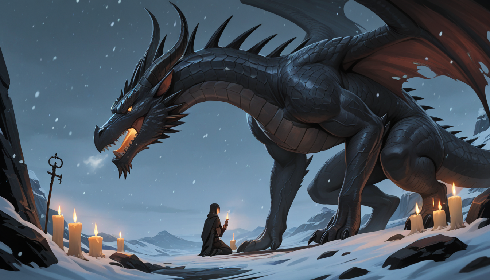

# 勇者斗恶龙 ～复仇～

一款 Godot 4.7.2 卡牌 roguelike。你扮演勇者小队里的第四个人——一个听得懂魔物说话的见习圣骑士。

**你讨伐的恶龙，是你的父亲。**



## 当前状态：第一幕 + 第二幕完整可玩

- **第一幕**：村庄整备 → 8 步铺路（每步三选一怪卡）→ 龙巢 Boss 战 → 七拍真相时刻
- **第二幕**：独自回程（人类卡池）→ 审判/释放抉择 → 处刑台决战勇者
- **四结局全部可触发**（见下表）
- 美术为 ComfyUI 生成的插画（CG×13、头像×16、双龙战斗立绘），音乐为 ACE-Step 生成的三首 BGM

## 运行

```bash
# 方式一：脚本（自动导入新资产再启动）
bash tools/play.sh

# 方式二：Godot 编辑器
# Import → 选择 project.godot → F5
```

系统需求：Godot 4.7.2 标准版、OpenGL 4.6 兼容显卡、中文字体（`sudo apt install fonts-noto-cjk`）。

## 操作

| 键 | 作用 |
|---|---|
| 空格 | 防御 QTE——怪物扑向主角的瞬间按（头顶有红"！"预警）；黄区=完美防御+反弹 |
| F | 闪避 QTE——窗口更小；成功=完全回避+反击（攻×1.2 无视防御），失败=吃满+失衡 |
| 按钮 | 三选一怪卡 / 攻击 / 血瓶 / 行商购物 / 审判·释放抉择 |

## 四结局

| 结局 | 触发条件 | 一句话 |
|---|---|---|
| 幻觉《白鸦》 | 真相时刻 SAN < 50 | 封印撑住了，他活在循环里 |
| 复仇（第二幕·完） | 觉醒后沾过血，打赢处刑台 | 剑落进雪里，丧钟撞了七下 |
| **真《不染雪》** | **第二幕 SAN 一滴不扣（全释放零杀）打穿处刑台** | 胜利靠真相，不靠刀剑 |
| 魔化《勇者斗恶龙》 | 第二幕 SAN = 0 | 锁链崩断，恨到不再是人 |

SAN 管理是核心技巧：战败 -10、审判 -15、安抚 +15 但永久 -5 最大生命（每局上限 6 次）。SAN < 50 命中 -10%，< 25 再 -20% + 心跳低语演出。

## 特色系统

- **怪卡三选一**：打赢的卡变成脚下的路——贪强卡=快但险，铺路步数决定遭遇强度（4-6 步威胁 +1 档，7-8 步 +2 档）
- **QTE 只属于主角**：三名 AI 队友自行判断；防御完美弹反、闪避反击、审判官二连击链
- **审判 / 释放**：第二幕每场人类战斗胜利后二选一——处决拿装备掉 SAN，放走收报恩留 SAN。你的每个决定都在决定结局
- **金币的死亡是叙事**：第二幕打胜仗不掉金币——复仇路上钱已无意义

## 技术栈

- **引擎**：Godot 4.7.2 / GDScript（gl_compatibility 渲染，1280×720）
- **数值**：伤害公式 `atk × 60/(60+def)`，经 3 策略 × 1000 局模拟校准（`tools/sim_balance.py`）
- **美术管线**：本地 ComfyUI API（SDXL Illustrious2.5D），`tools/gen_cg_comfy.py` 单命令重出任意 CG/头像，固定 seed 可复现；战斗立绘走绿幕抠图管线
- **音乐管线**：ACE-Step 本地推理（`tools/gen_music_ace.py`），BGM 同名替换零代码接入

## 项目结构

```
GDD/                     设计文档 ×12（剧情/数值/资产清单/魔龙技能组）
scripts/
  data/game_state.gd     Autoload 全局状态（SAN/杀孽/装备/进度）
  data/units_db.gd       数值总表（对应 GDD/07）
  data/cards_db.gd       怪卡与终局 Boss 卡
  combat/                回合引擎 + QTE + 队友 AI
  run/run_scene.gd       村庄/铺路/剧情面板/四结局
  ui/title_scene.gd      标题与序章三页
scenes/                  三个场景 tscn
assets/                  全部美术音频（按 GDD/09 规格，同名覆盖即替换）
tools/                   生图/生音/模拟/试玩机器人/启动脚本
```

## 自动化测试

```bash
AUTOPLAY=1 godot --headless --path .                          # 全流程自动通关（exit=0 即通过）
AUTOPLAY=1 AUTOPLAY_SPARE=1 godot --headless --path .         # 零杀线 → 真结局验证
FORCE_LOW_SAN=1 AUTOPLAY=1 godot --headless --path .          # 幻觉结局分支
BOT=1 godot --headless --path . + 挂载 tools/playtest_bot.gd   # 拟人操作机器人（QTE 掷骰画像）
```

## 致谢

- 引擎：[Godot Engine](https://godotengine.org)
- 美术：本地 ComfyUI + SDXL Illustrious2.5D（AI 生成）
- 音乐：ACE-Step（AI 生成）
- 字体：Noto Serif CJK
